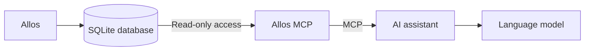

# Allos MCP

A read-only Model Context Protocol (MCP) server for
[Allos](https://github.com/FloorLamp/allos), a self-hosted
personal health tracker.

Allos MCP allows compatible AI assistants to interact with your
health data while keeping your original database under your control.

## Why Allos MCP?

Health trackers collect valuable information, but understanding
long-term patterns and relationships between different measurements
can be challenging.

Allos MCP allows AI assistants to retrieve relevant health data
directly from Allos, without manually exporting spreadsheets,
uploading database files or repeatedly copying measurements
into a conversation.

Potential use cases include:

- Exploring changes in health measurements over time.
- Comparing health metrics across different periods.
- Identifying potential patterns and correlations.
- Preparing summaries for medical appointments.
- Asking questions about your recorded health data.

Allos MCP does not replace Allos. It provides an additional
interface for interacting with your existing data.

## Features

- Read-only SQLite database access.
- Access restricted to a configured Allos profile.
- Compatible with MCP-enabled AI assistants.
- Local STDIO transport.
- Remote Streamable HTTP over HTTPS.
- Bearer token authentication for HTTP connections.
- DNS rebinding protection.
- Docker and Podman support.
- Linux AMD64 and ARM64 container images.

## How it works



Allos MCP reads the existing Allos database and exposes selected
health information through MCP tools.

It does not require a separate database and does not modify
your existing Allos data.

## Quick start

### Requirements

- An existing Allos installation.
- Docker or Podman.
- Access to the Allos data directory.
- The ID of the Allos profile you want to expose.
- An MCP-compatible AI assistant.

For remote HTTP connections, you also need:

- A TLS certificate and private key.
- A securely generated authentication token.
- A hostname matching the TLS certificate.

### Container image

Official container images are available through the GitHub
Container Registry.

Docker:

```sh
docker pull ghcr.io/mvrauwdeunt/allos-mcp:0.2.2
```

Podman:

```sh
podman pull ghcr.io/mvrauwdeunt/allos-mcp:0.2.2
```

See the [releases page](https://github.com/MVrauwdeunt/allos-mcp/releases)
for available versions.

Using a specific version is recommended for reproducible deployments.

### Prepare authentication and TLS

Create a directory for authentication and TLS credentials:

```sh
mkdir -p ./allos-mcp-secrets
chmod 700 ./allos-mcp-secrets

(
  umask 077
  openssl rand -hex 32 > ./allos-mcp-secrets/token
)
```

Place your TLS certificate and private key in this directory:

```text
allos-mcp-secrets/
├── token
├── server.crt
└── server.key
```

Use a certificate trusted by your MCP client and valid for
the hostname used to connect to the server.

Do not disable TLS certificate verification.

The container user must have permission to read these files.
Keep the token and private key inaccessible to other users.

### Docker Compose

Create a `compose.yaml` file:

```yaml
services:
  allos-mcp:
    image: ghcr.io/mvrauwdeunt/allos-mcp:0.2.2
    container_name: allos-mcp

    user: "${ALLOS_UID:-10001}:${ALLOS_GID:-10001}"

    environment:
      ALLOS_DB_PATH: /data/allos.db
      ALLOS_PROFILE_ID: "${ALLOS_PROFILE_ID:?Set profile ID}"

      ALLOS_MCP_AUTH_TOKEN_FILE: /run/secrets/token
      ALLOS_MCP_TLS_CERT_FILE: /run/secrets/server.crt
      ALLOS_MCP_TLS_KEY_FILE: /run/secrets/server.key

      ALLOS_MCP_ALLOWED_HOSTS: "${ALLOS_MCP_ALLOWED_HOSTS:-localhost:8765}"

      HOME: /tmp
      TMPDIR: /tmp

    volumes:
      - "${ALLOS_DATA_DIR:?Set data directory}:/data:ro"
      - "${ALLOS_SECRETS_DIR:?Set secrets directory}:/run/secrets:ro"

    ports:
      - "${ALLOS_BIND_ADDRESS:-127.0.0.1}:8765:8765"

    command:
      - "--transport"
      - "http"
      - "--host"
      - "0.0.0.0"
      - "--port"
      - "8765"
      - "--allow-nonloopback"

    read_only: true

    tmpfs:
      - /tmp:rw,nosuid,nodev,size=16m

    security_opt:
      - no-new-privileges:true

    cap_drop:
      - ALL

    restart: unless-stopped
```

Create a `.env` file alongside it:

```dotenv
ALLOS_DATA_DIR=/path/to/allos/data
ALLOS_SECRETS_DIR=/path/to/allos-mcp-secrets

ALLOS_PROFILE_ID=1

ALLOS_UID=10001
ALLOS_GID=10001

ALLOS_BIND_ADDRESS=127.0.0.1
ALLOS_MCP_ALLOWED_HOSTS=localhost:8765
```

Adjust the profile ID, paths and user permissions to match
your installation.

Start the container:

```sh
docker compose up -d
```

For Podman with a Compose provider installed:

```sh
podman compose up -d
```

View the container logs:

```sh
docker compose logs -f allos-mcp
```

Or:

```sh
podman logs -f allos-mcp
```

### Docker or Podman without Compose

The following example uses Podman. Replace `podman` with
`docker` when using Docker.

```sh
podman run -d \
  --name allos-mcp \
  --user 10001:10001 \
  --read-only \
  --cap-drop ALL \
  --security-opt no-new-privileges \
  --tmpfs /tmp:rw,nosuid,nodev,size=16m \
  --restart unless-stopped \
  -p 127.0.0.1:8765:8765 \
  -v /path/to/allos/data:/data:ro \
  -v /path/to/allos-mcp-secrets:/run/secrets:ro \
  -e ALLOS_DB_PATH=/data/allos.db \
  -e ALLOS_PROFILE_ID=1 \
  -e ALLOS_MCP_AUTH_TOKEN_FILE=/run/secrets/token \
  -e ALLOS_MCP_TLS_CERT_FILE=/run/secrets/server.crt \
  -e ALLOS_MCP_TLS_KEY_FILE=/run/secrets/server.key \
  -e ALLOS_MCP_ALLOWED_HOSTS=localhost:8765 \
  -e HOME=/tmp \
  -e TMPDIR=/tmp \
  ghcr.io/mvrauwdeunt/allos-mcp:0.2.2 \
  --transport http \
  --host 0.0.0.0 \
  --port 8765 \
  --allow-nonloopback
```

Mount the complete Allos data directory, not just the SQLite
database file. SQLite may also require access to its WAL
and SHM files.

Ensure the container user can read the database and credentials.

## Connecting your AI assistant

### Remote HTTP

Configure your MCP client with the server URL and
an Authorization header.

Example configuration:

```json
{
  "mcpServers": {
    "allos": {
      "url": "https://localhost:8765/mcp",
      "headers": {
        "Authorization": "Bearer YOUR_TOKEN"
      }
    }
  }
}
```

The exact configuration format depends on your AI assistant.
It must support Streamable HTTP and custom authentication headers.

Where supported, use environment variables or a secret manager
instead of placing tokens directly in configuration files.

### Access from another device

To access Allos MCP from another device, configure an appropriate
network bind address and the corresponding allowed hostname.

For example:

```dotenv
ALLOS_BIND_ADDRESS=192.168.1.10
ALLOS_MCP_ALLOWED_HOSTS=health.example.com:8765
```

Your client would then connect to:

```text
https://health.example.com:8765/mcp
```

The hostname must resolve to the server and match its TLS
certificate.

Multiple allowed hosts can be specified as a comma-separated list.

A private network or VPN, such as Tailscale or WireGuard,
is recommended instead of exposing Allos MCP directly
to the public internet.

### Local STDIO

For AI assistants running on the same machine, STDIO provides
an alternative without exposing an HTTP endpoint.

Example:

```sh
podman run --rm -i \
  --network none \
  --read-only \
  --cap-drop ALL \
  --security-opt no-new-privileges \
  --user 10001:10001 \
  --tmpfs /tmp:rw,nosuid,nodev,size=16m \
  -v /path/to/allos/data:/data:ro \
  -e ALLOS_DB_PATH=/data/allos.db \
  -e ALLOS_PROFILE_ID=1 \
  -e HOME=/tmp \
  -e TMPDIR=/tmp \
  ghcr.io/mvrauwdeunt/allos-mcp:0.2.2 \
  --transport stdio
```

Configure your MCP client to launch this command directly.
Do not allocate a terminal with `-t`, as STDIO communication
uses standard input and output.

## Available tools

| Tool | Purpose |
|---|---|
| `allos_catalog` | Discover available health data. |
| `allos_metrics` | Discover available health metrics. |
| `allos_read` | Retrieve recorded health information. |

The available data depends on your Allos installation,
database schema and configured profile.

## Example questions

Once connected, you can ask your AI assistant questions such as:

- What health metrics are available in my Allos database?
- How has my weight changed over the last three months?
- Summarize my recorded health measurements for the past week.
- Are there any noticeable patterns in my recorded measurements?
- Prepare a summary of my recent measurements for my doctor.

AI-generated observations should always be checked against
the original data.

## Privacy and health data

> **Self-hosted does not necessarily mean private. Read-only
> does not mean that your data cannot leave your network.**

Allos MCP runs under your control and accesses your local
health database.

However, when an AI assistant retrieves information through MCP,
that information may be sent to the language model processing
your request.

### What happens to your data?

Depending on your AI assistant and model provider, retrieved
health information may be included in:

- Requests sent to an external AI provider.
- Conversation history.
- Application and diagnostic logs.
- Persistent AI memory.
- Agent databases and external integrations.
- Provider-side data retention or model training, depending
  on the provider's policies and your account settings.

Allos MCP cannot control how an MCP client or language model
stores, processes or redistributes retrieved information.

Running Allos MCP locally does not prevent a cloud-based
language model from receiving health data.

### Local versus cloud-based AI

| Configuration | Privacy implications |
|---|---|
| Local MCP and local language model | Can keep processing within your own infrastructure, provided the entire stack is configured accordingly. |
| Local MCP and cloud language model | Retrieved health data may be transmitted to an external provider. |
| Remote MCP and cloud language model | Health data may pass through multiple systems and external services. |

A fully local configuration offers greater control, but
does not automatically eliminate risks from logging, telemetry,
backups or additional integrations.

### Recommendations

- Use a local language model if health data must remain private.
- Review your AI provider's privacy and retention policies.
- Disable unnecessary conversation retention and persistent memory
  where supported.
- Limit access to the intended Allos profile.
- Retrieve only the information necessary for the task.
- Avoid sharing health information belonging to other people
  without appropriate authorization.
- Keep authentication tokens and TLS private keys secure.
- Do not expose the MCP server unnecessarily.
- Keep Allos MCP and your AI software up to date.

Health data is particularly sensitive and may be subject to
additional legal protections, including the GDPR in Europe.

You are responsible for determining whether your configuration
and use of external AI services are appropriate for your data.

## Security model

Allos MCP is designed around limited access:

- The Allos database is accessed in read-only mode.
- Access is restricted to the configured profile ID.
- HTTP connections require TLS and Bearer authentication.
- DNS rebinding protection restricts accepted hostnames.
- The official container runs as a non-root user by default.
- The container can run with a read-only filesystem and
  without additional Linux capabilities.

The configured profile ID is a server-side access restriction.
Anyone possessing the server's authentication token may access
the health data exposed by that server.

For separate users or profiles, use separate server instances
with individual credentials.

Read-only access protects database integrity. It does not
guarantee confidentiality after data has been retrieved.

See [SECURITY.md](SECURITY.md) for additional security information
and vulnerability reporting.

## Medical disclaimer

Allos MCP is a personal health data integration, not a
medical device or diagnostic system.

Language models can misinterpret measurements, overlook
important information, invent explanations or confuse
correlation with causation.

Do not rely on AI-generated interpretations for diagnosis,
medication changes, treatment decisions or emergency situations.

Discuss medical concerns and significant changes in your
health with a qualified healthcare professional.

## Troubleshooting

### HTTP 401

The authentication token is missing or incorrect.

Check the Authorization header and the server's configured
token file.

### HTTP 421

The requested hostname is not on the server's allowed host list.

Check `ALLOS_MCP_ALLOWED_HOSTS` and include the hostname
and port used by your MCP client.

Do not disable DNS rebinding protection to work around
this error.

### TLS certificate errors

Check that:

- The certificate has not expired.
- The hostname matches the certificate.
- The client trusts the certificate issuer.
- The configured certificate and private key belong together.

### Database access errors

Check that:

- The database directory is mounted correctly.
- The database and SQLite companion files are readable.
- The configured container UID and GID have sufficient access.
- The selected Allos profile exists.

See [COMPATIBILITY.md](COMPATIBILITY.md) for database
compatibility information.

## Configuration reference

| Variable | Purpose |
|---|---|
| `ALLOS_DB_PATH` | SQLite database path inside the container. Defaults to `/data/allos.db`. |
| `ALLOS_PROFILE_ID` | Required Allos profile ID. |
| `ALLOS_MCP_AUTH_TOKEN_FILE` | Path to the HTTP authentication token. |
| `ALLOS_MCP_TLS_CERT_FILE` | Path to the TLS certificate. |
| `ALLOS_MCP_TLS_KEY_FILE` | Path to the TLS private key. |
| `ALLOS_MCP_ALLOWED_HOSTS` | Comma-separated list of additional allowed HTTP hosts. |

## Links

- [Allos](https://github.com/FloorLamp/allos)
- [Allos MCP releases](https://github.com/MVrauwdeunt/allos-mcp/releases)
- [Container images](https://github.com/MVrauwdeunt/allos-mcp/pkgs/container/allos-mcp)
- [Model Context Protocol](https://modelcontextprotocol.io/)
- [Report an issue](https://github.com/MVrauwdeunt/allos-mcp/issues)

## License

Allos MCP is licensed under the
[GNU Affero General Public License v3.0](LICENSE).

Allos MCP is an independent integration for Allos.
